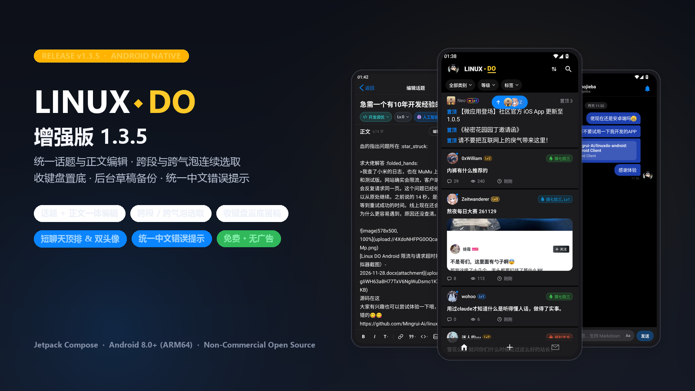
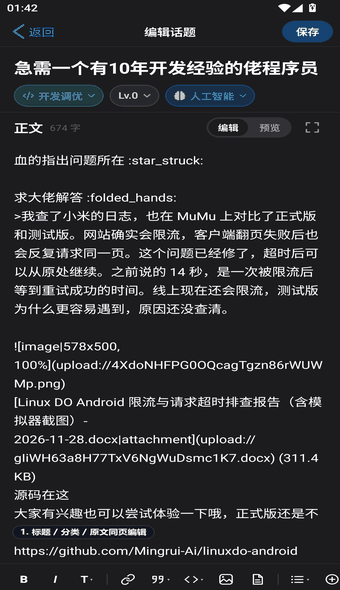
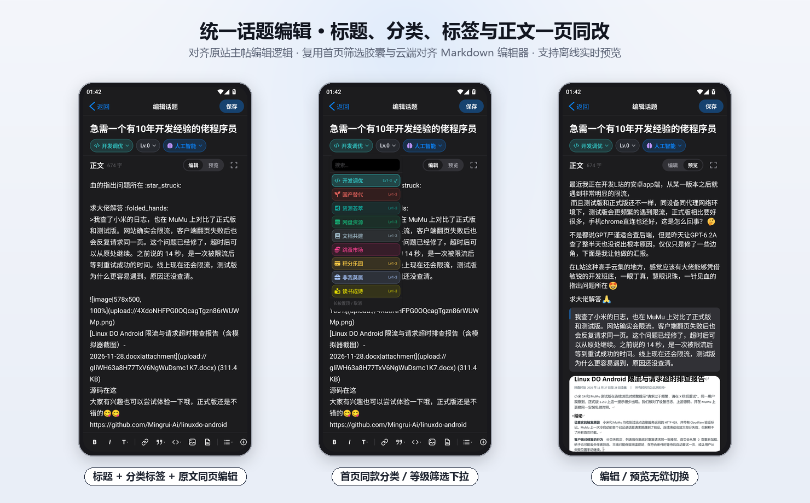
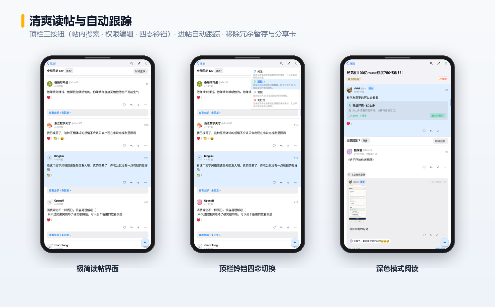

<div align="center">



<br />

<h1>LINUX DO 增强版</h1>

<p>
  面向 <a href="https://linux.do/">LINUX DO</a> 社区的原生 Android 客户端<br />
  基于 <a href="https://github.com/xuemk/linuxdo-android">xuemk/linuxdo-android</a> 独立维护 · 免费 · 非商业 · 无广告
</p>

<p>
  <a href="https://github.com/Mingrui-Ai/linuxdo-android/releases/tag/enhanced-v1.3.5">
    
  </a>
  
  
  <a href="./LICENSE">
    
  </a>
</p>

<p>
  <a href="https://github.com/Mingrui-Ai/linuxdo-android/releases/tag/enhanced-v1.3.5"><strong>⬇️ 下载增强版 1.3.5 APK</strong></a>
  &nbsp;·&nbsp;
  <a href="#-动态亮点演示">动态演示</a>
  &nbsp;·&nbsp;
  <a href="#-界面一览">界面一览</a>
  &nbsp;·&nbsp;
  <a href="#-v135-重点更新">v1.3.5 更新</a>
  &nbsp;·&nbsp;
  <a href="#-下载与构建">构建指南</a>
</p>

</div>

---

## ✨ 动态亮点演示

<div align="center">
<table>
  <tr>
    <td align="center" width="33%">
      <strong>📝 统一话题与正文编辑</strong><br />
      <sub>标题 / 分类 / 标签 / 原文同页编辑与预览</sub><br /><br />
      
    </td>
    <td align="center" width="33%">
      <strong>📨 消息置顶 · 短聊顶排 &amp; 双侧头像</strong><br />
      <sub>新通知顶齐 · 快捷栏去重 · 聊天气泡 MD</sub><br /><br />
      
    </td>
    <td align="center" width="33%">
      <strong>💬 实时回复 · 跳动三点动画</strong><br />
      <sub>对齐网页 Presence，头像 + 1.8s 三点波浪</sub><br /><br />
      
    </td>
  </tr>
</table>
</div>

---

## 📱 界面一览

### 📝 统一话题编辑 · 标题、分类、标签与正文一页同改


### 💬 消息板块打磨 · 新通知顶齐 · 短会话顶排与双侧头像


### ✍️ 全场景 Markdown 编辑 · 云端对齐工具栏 · 新版发帖页


### 📖 清爽读帖 · 回复数与楼中楼排序 · 紧凑简评与表情回应


### 🏠 首页多维筛选 · 最新动态排序 · 低等级权限提示


### 🌙 浅色 & AMOLED 纯黑深色自适应


---

## 🚀 核心特性

| 模块 | 亮点 |
| --- | --- |
| **📝 全场景编辑与发帖** | 新话题、话题主帖编辑、回帖与直接消息共用同一套 Markdown 编辑体系：统一的话题编辑页对齐原站逻辑，可同页修改 **标题、分类、Lv 等级、标签与 1 楼 Markdown 原文** 并实时预览；自己可编辑的回帖右下角直接显示铅笔按钮，默认全屏展开编辑；支持自动后台备份草稿（联网补同步、无弹窗打扰），回复与简评支持**收键盘置底保留现场**与**提交失败保持键盘/原文/附件**。 |
| **📋 跨段落与跨气泡连续选取** | 帖子整层正文与直接消息（含群聊）均支持跨段落、标题、列表、引用与代码块连续选取和全选复制，保留原始换行；图片、时间与互动控件不混入选区；正文长按选取菜单原生接入「引用回复」。 |
| **💬 重构消息与直接消息** | 与首页同源两层顶栏，底栏切换首页 ↔ 消息零位移秒切；有新通知进入消息页自动顶齐不被顶出；直接消息采用 46dp IM 双行排版、顶部快捷栏（可开关）且自动去重「新对话」入口；短会话从顶栏下方排列、支持轻拖回弹，我方气泡右侧展示头像；发送后自动置底，气泡完整渲染 Markdown。 |
| **📖 沉浸读帖与实时互动** | 回复栏同步展示 **「正在回复…」真实头像 + 1.8s 跳动三点波浪**；支持「默认楼中楼 / 全部展开」与 4 种排序（时间正序/倒序、按点赞数、按回复数）；表情回应点击取消/长按切换、汇总单一总数；支持「阅读后自动跟随」开关与时长设置，已看话题实时消除首页未读蓝点。 |
| **🏠 首页筛选与流畅浏览** | `类别 / 等级 / 标签` 三维组合筛选，支持 **「最新动态」** 排序；等级菜单直观区分可见/未解锁/需登录并直达「等级与积分」；支持左滑关注/免打扰、新帖头像胶囊与独立列表排序记忆。 |
| **🛡️ 统一中文提示与网络底座** | 全站接口与网络异常统一转为清晰易读中文，剥离原始 JSON / HTML 与 HTTP 状态码透传；内置 DoH / ECH 与「内置网络 / 跟随系统」切换；图片与业务请求队列隔离；全新「曜石黑底 · 跃升 L+」品牌图标与原生个人主页。 |

---

## 🎉 v1.3.5 重点更新

### 📝 统一话题编辑与写作手感升级
- ✨ **统一话题与主帖正文编辑**：对齐原站逻辑，顶栏铅笔与 1 楼编辑统一进入整页话题编辑器，复用首页同款 **分类 / Lv 等级 / 标签** 筛选胶囊与全功能 Markdown 编辑器（含离线预览、专注全屏、附件与投票）；按服务端权限自动区分「仅改元信息」与「同改正文」，按需顺序保存不丢稿。
- ✏️ **自己回帖直达编辑**：自己可编辑的回帖在右下角操作区直接展示铅笔按钮，点击即以全屏展开态进入 Markdown 编辑器，更多菜单不重复冗余。
- 💾 **草稿自动后台备份 & 正文全高**：发帖页正文铺满可用空间、收起键盘不误退出；返回即刻保存并由 WorkManager 联网后台补同步草稿，告别「草稿尚未同步」打断弹窗；专注正文时顶栏显示话题标题。
- ⌨️ **回复 & 简评收键盘置底 + 失败不丢现场**：回复与简评统一区分「收起键盘」与「系统返回」——收起键盘自动折叠为紧凑底栏、移除遮罩方便边翻帖边写，点输入框秒恢复；提交校验失败时保持输入框与键盘展开、保留原文与附件且仅显示清晰原因。

### 📋 帖子与直接消息跨区连续选取
- 📑 **帖子正文跨段落连续选取**：整层楼正文共用连续选区，可跨段落、标题、引用、列表、表格与代码块自由拖动选择及全选复制并保留换行，菜单原生支持「引用回复」，不混入图片或按钮文字。
- 🫧 **直接消息跨气泡连续选取**：直接消息与群聊支持跨自己和对方的多个气泡连续选字与全选复制；加载历史或图片高度变化时精准锚定阅读位置，选字期间收到新消息不自动跳底。

### 💬 直接消息与通知体验打磨
- 📌 **新通知顶齐不被顶走**：修复收到新通知后从首页切入消息页时顶部最新通知被顶出可视区、需要手动下拉的问题，通知列表与聊天列表均加入顶部锚点与智能归顶。
- 🎯 **短会话顶排、双侧头像与发送置底**：消息不足一屏时从顶栏下方自然排列并支持上下轻拖回弹；我方聊天气泡右侧显示真实头像（支持点击查资料）；发送成功或首进会话自动定位底部，且隐藏快捷栏时才显示右侧备用「新对话」按钮，避免入口重复。

### 🛡️ 全站错误提示治理
- 🧹 **统一清晰中文提示**：收敛全站 20+ 处接口与网络错误展示，自动提取服务端具体说明并翻译常见英文提示，彻底移除原始 JSON、HTML 与 `HTTP 4xx/5xx` 状态码透传，同时完整保留登录判定、安全验证与限流处理流程。

---

## ⬇️ 下载与构建

### 下载安装

前往 [Releases](https://github.com/Mingrui-Ai/linuxdo-android/releases/tag/enhanced-v1.3.5) 下载 **`linuxdo-enhanced-1.3.5-arm64-v8a.apk`**（Android 8.0+ / `arm64-v8a`）。

- 包名 `org.linuxdo.android.enhanced`，独立签名，可与原版共存；从增强版 `1.0 / 1.1 / 1.1.1 / 1.2.0 / 1.2.5 / 1.3.0` 升级可直接覆盖保留数据，并支持应用内自动检查更新。
- 公开 Release 仅发布正式版 APK，附带 `version.json`、`SHA256SUMS`、`LICENSE`、`THIRD_PARTY_NOTICES` 与公开签名证书 `release-certificate.pem`。

<details>
<summary><strong>🛠️ 本地编译与签名构建指南（点击展开）</strong></summary>

- 环境要求：JDK 21、Android SDK 36，本地 `local.properties` 配置 `sdk.dir`（不提交）。

```powershell
git clone --branch master --single-branch https://github.com/Mingrui-Ai/linuxdo-android.git
cd linuxdo-android

# 编译 Debug 包（app/build/outputs/apk/debug/app-debug.apk）
.\gradlew.bat :app:assembleDebug

# 编译并覆盖安装到已连接设备（-Performance 开启性能构建 + ART 预编译）
.\run-debug.ps1 -DeviceSerial "设备序列号" -Performance
```

正式版签名构建：在根目录配置本地 `keystore.properties`（`storeFile` / `storePassword` / `keyAlias` / `keyPassword`，不提交），运行 `./gradlew :app:assembleRelease`。

</details>

---

## 📜 授权与致谢

原作者 **xuemk** 已于 2026 年 11 月 23 日[明确授权非商业修改、公开维护与免费分发衍生 APK](https://github.com/xuemk/linuxdo-android/issues/15#issuecomment-7101351472)。本项目遵循 [LinuxDo Android Non-Commercial License](./LICENSE)（非商业、无广告、保留原作者署名与独立包名/签名/图标），第三方依赖遵循各自许可证。

感谢 [xuemk](https://github.com/xuemk) 的开源基础与 [LINUX DO](https://linux.do/) 社区支持（[原项目帖](https://linux.do/t/topic/2998703)）。欢迎向 `master` 分支提交 [PR / Issue](https://github.com/Mingrui-Ai/linuxdo-android/pulls)。
