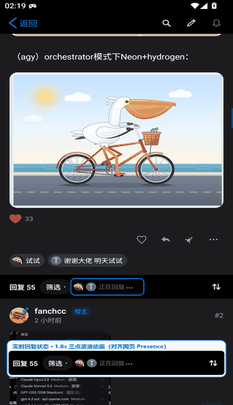
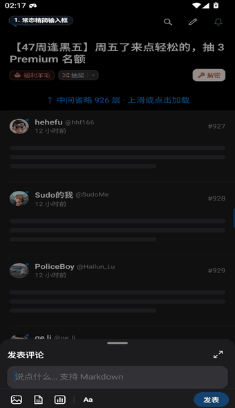
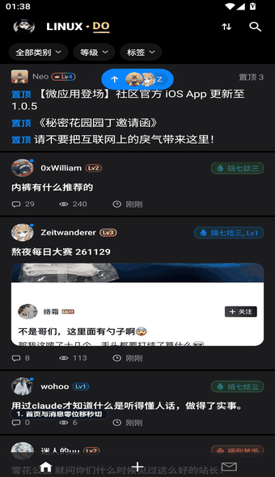
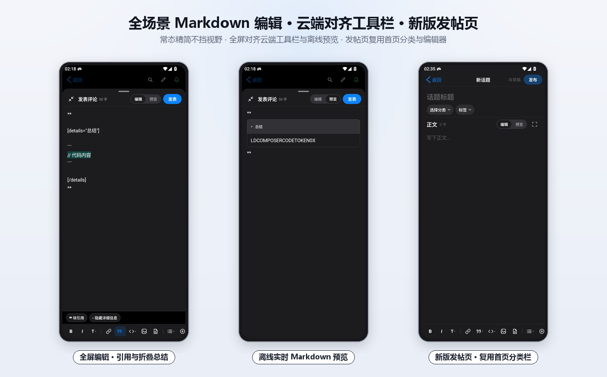
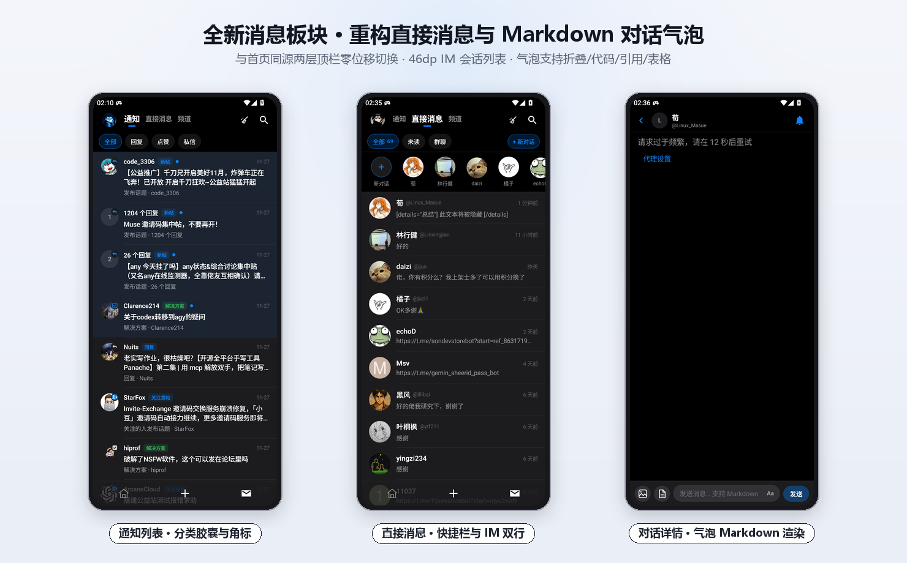
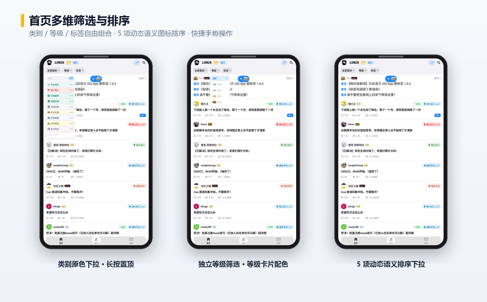

<div align="center">


<br />

<h1>LINUX DO 增强版</h1>

<p>
  面向 <a href="https://linux.do/">LINUX DO</a> 社区的原生 Android 客户端<br />
  基于 <a href="https://github.com/xuemk/linuxdo-android">xuemk/linuxdo-android</a> 独立维护 · 免费 · 非商业 · 无广告
</p>

<p>
  <a href="https://github.com/Mingrui-Ai/linuxdo-android/releases/tag/enhanced-v1.3.0">
    
  </a>
  
  
  <a href="./LICENSE">
    
  </a>
</p>

<p>
  <a href="https://github.com/Mingrui-Ai/linuxdo-android/releases/tag/enhanced-v1.3.0"><strong>⬇️ 下载增强版 1.3.0 APK</strong></a>
  &nbsp;·&nbsp;
  <a href="#-动态亮点演示">动态演示</a>
  &nbsp;·&nbsp;
  <a href="#-界面一览">界面一览</a>
  &nbsp;·&nbsp;
  <a href="#-v130-重磅更新">v1.3.0 更新</a>
  &nbsp;·&nbsp;
  <a href="#-下载与构建">构建指南</a>
</p>

</div>

---

## ✨ 动态亮点演示

<div align="center">
<table>
  <tr>
    <td align="center" width="33%">
      <strong>💬 实时回复 · 跳动三点动画</strong><br />
      <sub>对齐网页 Presence，头像 + 1.8s 三点波浪</sub><br /><br />
      
    </td>
    <td align="center" width="33%">
      <strong>✍️ 全场景 Markdown 编辑与预览</strong><br />
      <sub>常态精简 Aa · 全屏云端工具栏 · 离线预览</sub><br /><br />
      
    </td>
    <td align="center" width="33%">
      <strong>📨 重构消息 & 直接消息 MD 对话</strong><br />
      <sub>与首页零位移切换 · IM 双行 · 气泡 MD</sub><br /><br />
      
    </td>
  </tr>
</table>
</div>

---

## 📱 界面一览

### ✍️ 全场景 Markdown 编辑 · 云端对齐工具栏 · 新版发帖页


### 💬 全新消息板块 · 重构直接消息与 Markdown 气泡


### 📖 清爽读帖 · 回复数与楼中楼排序 · 紧凑简评与表情回应


### 🏠 首页多维筛选 · 最新动态排序 · 低等级权限提示


### 🌙 浅色 & AMOLED 纯黑深色自适应


---

## 🚀 核心特性

| 模块 | 亮点 |
| --- | --- |
| **✍️ 全场景 Markdown 编辑** | 回帖、发帖与直接消息共用全新 Markdown 编辑器：常态精简低矮不挡视野，点 `Aa` 展开常用格式条；展开全屏完整对齐 LINUX DO 云端（Discourse `composer-redesign`）底部工具栏，含引用下拉 `[details="总结"]` 折叠块、模糊剧透、表格、待办清单、投票与脚注；支持离线实时预览与键盘避让。回复字数不足或提交失败时保留输入框、手机键盘、正文和附件，仅显示失败原因，可继续修改重试；成功后自动关闭。 |
| **💬 重构消息与直接消息** | 与首页同源两层顶栏，底栏切换首页 ↔ 消息零位移秒切；通知 / 直接消息 / 频道三入口平级展示；直接消息采用 46dp IM 双行排版、顶部最近联系人快捷栏（设置中可开关，默认开启）与 `+ 新对话` 实时搜人；聊天气泡全面支持 Markdown（粗斜删、代码、引用、列表、表格、折叠块与表情）并强化浅深色高对比度。 |
| **📖 沉浸读帖与实时互动** | 回复栏新增与网页端一致的 **「正在回复…」真实头像 + 1.8s 跳动三点波浪**；支持「默认楼中楼 / 全部展开」与 4 种排序（时间正序/倒序、按点赞数、按回复数），楼中楼操作统一右对齐；自己的可编辑回帖在右下角直接显示铅笔按钮；表情回应点击取消/长按切换，汇总图标降序合并单总数；简评栏压矮合并输入框与发送胶囊；支持「阅读后自动跟随」开关与等待时长设置，已看话题实时消除首页未读蓝点。 |
| **🏠 首页筛选与流畅浏览** | `类别 / 等级 / 标签` 三维组合筛选，新增 **「最新动态」** 排序；等级菜单区分可见/未解锁/需登录，底部直达「等级与积分」；修复顶栏展开列表抖动与翻页恢复；支持左滑关注/免打扰、X 风格新帖头像胶囊（左高右低叠放）与独立列表排序记忆。 |
| **👤 个人主页与侧栏** | 侧栏固定展示等级、状态、点数、勋章、简介与关注粉丝；详细主页支持 26 项自定义显示开关、封面大图、原生资料编辑与网页版常规/免打扰/忽略同步；草稿、收藏、徽章、关注与历史页统一视觉语言。 |
| **🌐 网络与细节体验** | 内置 DoH / ECH 与「内置网络 / 跟随系统」切换；图片与业务请求队列隔离；常用小程序广场（授权失败自动恢复不遮挡）；全新「曜石黑底 · 跃升 L+」品牌图标与登录页。 |

---

## 🎉 v1.3.0 重磅更新

- 💬 **统一错误提示**：接口和网络异常显示易读中文，保留服务端的具体原因，过滤原始 JSON、HTML 与 HTTP 状态码；登录成功判定、安全验证及限流仍按原流程处理。

### ✍️ 全场景 Markdown 编辑器与新版发帖页
- 🚀 **回帖 Markdown 编辑器全面升级**：常态精简 + `Aa` 快捷格式条，全屏对齐云端工具栏分组顺序，内置离线实时预览，支持 `[details="总结"]` 折叠块、剧透、表格、待办、代码与投票。
- 📝 **新版发帖页**：复用首页同款类别/标签筛选栏与 Markdown 编辑器，支持草稿箱一键新建与置顶防遮挡；正文铺满可用空间并支持长文滚动，收起输入法保留编辑页面。返回直接保存并后台同步草稿，退出应用后联网补同步；展开正文时顶栏显示帖子标题。
- 📋 **正文连续选取**：长按正文可跨段落、标题、列表、引用和代码块连续选择，整层正文支持全选复制并保留换行；引用回复使用完整选区，图片和互动按钮不混入复制文本。
- ⚡ **输入法丝滑动画与紧凑简评**：回复与简评均支持侧滑返回关闭编辑器并保留未发送内容；只收起输入法则保留底部输入框，可继续滚动看帖，点输入框恢复输入。列表按置底输入栏高度预留空间；简评栏字数移至右上角并合并输入与发送按钮，移除输入框底部冗余草稿同步提示。

### 💬 消息板块与直接消息彻底重构
- ✨ **首页同源顶栏，零位移秒切**：通知 / 直接消息 / 频道平级导航，切换首页与消息时左上角头像、右上角搜索与两级栏高度纹丝不动。
- 💌 **标准 IM 双行会话 & 顶部快捷栏**：46dp 头像（群聊自动 2×2 拼贴）、全部/未读/群聊筛选胶囊；头像栏显示时只保留最左侧「新对话」，隐藏头像栏时显示备用入口。顶部最近联系人快捷栏可在「设置 → 通知与保活」中自由开关（默认开启）。
- 🎨 **直接消息支持 Markdown 输入与气泡渲染**：复用回帖同款编辑器，气泡完整渲染服务端 HTML 与本地 Markdown，浅/深色高对比度清晰易读，并修复并发发送去重与草稿清理。
- 📋 **直接消息跨气泡选取**：长按正文后可在自己与对方的多个气泡间连续选择，跨段落、引用和代码块复制并保留换行；全选包含当前已加载的消息正文，时间与控件不混入。加载历史保留阅读位置，选取期间新消息不自动跳到底部。
- ⬇️ **发送后自动置底**：首次进入聊天和主动发送成功后定位最新消息；直接消息底部图片或正文高度变化时继续贴底，浏览历史及选取文字时收到其他消息仍保留阅读位置。
- 💬 **短会话顶部排列与双侧头像**：消息不足一屏时从顶栏下方依次排列，空白保留在消息下方，支持上下轻拖并回弹；我方气泡右侧显示头像，连续消息沿用分组头像，点击可打开个人资料。

### 📖 读帖体验与实时互动升级
- 👀 **实时回复状态提示**：回复栏同步展示正在回复的佬友头像与 1.8 秒跳动三点波浪，与网页端 Presence 协议一致。
- 🌲 **回复显示模式与排序分离**：排序菜单独立切换「默认（保留楼中楼）/ 全部展开」，新增 **「按回复数」** 排序；“查看全部回复”与“收起回复”统一右对齐；移除回复栏上下异色细边。
- ❤️ **表情回应与自动跟随**：主帖/回复点赞按钮去红圈背景、直接展示当前回应表情并汇总单一总数；新增「阅读后自动跟随」设置（默认 3 秒，可关闭或自定义 1–3600 秒）；已看话题自动消除首页未读蓝点。

### 🏠 首页筛选、排序与稳定性修复
- 🔥 **新增「最新动态」排序**，并精简排序菜单宽度与单行说明；优化新帖悬浮按钮头像叠放顺序。
- 🛡️ **低等级权限提示与积分入口**：等级菜单直观区分可见/未解锁状态，底部可一键直达「等级与积分」页面。
- 🔧 **细节打磨**：修复首页上下栏展开时的列表抖动、翻页失败重载首屏，以及小程序授权失败后遮挡授权页的问题。

---

## ⬇️ 下载与构建

### 下载安装

前往 [Releases](https://github.com/Mingrui-Ai/linuxdo-android/releases/tag/enhanced-v1.3.0) 下载 **`linuxdo-enhanced-1.3.0-arm64-v8a.apk`**（Android 8.0+ / `arm64-v8a`）。

- 包名 `org.linuxdo.android.enhanced`，独立签名，可与原版共存；从增强版 `1.0 / 1.1 / 1.1.1 / 1.2.0 / 1.2.5` 升级可直接覆盖保留数据，并支持应用内自动检查更新。
- 公开 Release 仅发布正式版 APK，附带 `version.json`、`SHA256SUMS`、`LICENSE`、`THIRD_PARTY_NOTICES` 与公开签名证书 `release-certificate.pem`。

<details>
<summary><strong>🛠️ 本地编译与签名构建指南（点击展开）</strong></summary>

- 环境要求：JDK 21、Android SDK 36，本地 `local.properties` 配置 `sdk.dir`（不提交）。

```powershell
git clone --branch master --single-branch https://github.com/Mingrui-Ai/linuxdo-android.git
cd linuxdo-android

# 编译 Debug 包（app/build/outputs/apk/debug/app-debug.apk）
.\gradlew.bat :app:assembleDebug

# 编译并覆盖安装到已连接设备（-Performance 开启性能构建 + ART 预编译）
.\run-debug.ps1 -DeviceSerial "设备序列号" -Performance
```

正式版签名构建：在根目录配置本地 `keystore.properties`（`storeFile` / `storePassword` / `keyAlias` / `keyPassword`，不提交），运行 `./gradlew :app:assembleRelease`。

</details>

---

### 2026-11-29 · 登录后的请求与限流

在独立 Android 15 模拟器上，首页已经可用时，浏览历史 `/read.json` 仍收到过 HTTP 429，子站授权 `/oauth2/authorize` 也收到过 HTTP 403。两条响应都带有 `cf-mitigated: challenge`。旧版每 30 秒尝试同步浏览历史；登录后即使不打开账户页面，也会安排等级、积分及社区分的网络预取。

此分支将远端浏览历史同步移到打开历史、下拉刷新和翻页时。本地浏览记录继续随阅读保存。账户页面按需读取并复用缓存；首页不再为等级、积分和社区分启动预取，话题页的已读校准只查询仍未确认的可见楼层。服务器实际给出的限流和访问限制仍需遵守。

在同一台模拟器上，给原版 APK 的请求层注入 `429` 和 `Retry-After: 1`，一次普通写入和一次附件上传分别发出了两次请求。此分支在交还发送位置前就登记限流，写入和上传均由用户决定何时重新提交。账户资料读取也区分了本地排队和已经收到的服务端 429，只有短暂的本地排队会自动再试一次。

首页新话题与普通前台通知的默认检查间隔均为 1 分钟。切回列表后首次新话题检查也遵守所选间隔；用户已保存的新话题频率、关闭选项和实时通知频率继续生效。手动刷新仍可立即发起，并遵守现有站点冷却。

同一登录账号在首页静置 3 分钟，旧版诊断记录到 7 次首页列表、9 次通知和 6 次浏览历史读取。单独取消历史定时同步后，等长窗口分别为 7、8、0 次。最终版分别为 3、3、0 次，三个接口合计从 22 次降至 6 次。这三段样本中实际发出的上述请求全部返回 200。手动打开浏览历史后，最终版请求一次并返回 200。另一次观测遇到 `SSLHandshakeException / ech_config_missing`，连接在取得 HTTP 响应前中断，未计入这组对照。

在最终安装的 APK 上，8 个本地传输用例全部通过，涵盖写入、上传、带挑战标记的 429、90 秒冷却下的并发请求、回应额度、正常成功及账户读取。网络使用替身，测试未向论坛提交写操作。上述数字只覆盖指定接口和观测时段。

## 📜 授权与致谢

原作者 **xuemk** 已于 2026 年 11 月 23 日[明确授权非商业修改、公开维护与免费分发衍生 APK](https://github.com/xuemk/linuxdo-android/issues/15#issuecomment-7101351472)。本项目遵循 [LinuxDo Android Non-Commercial License](./LICENSE)（非商业、无广告、保留原作者署名与独立包名/签名/图标），第三方依赖遵循各自许可证。

感谢 [xuemk](https://github.com/xuemk) 的开源基础与 [LINUX DO](https://linux.do/) 社区支持（[原项目帖](https://linux.do/t/topic/2998703)）。欢迎向 `master` 分支提交 [PR / Issue](https://github.com/Mingrui-Ai/linuxdo-android/pulls)。
