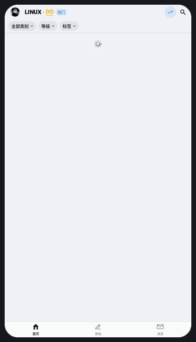
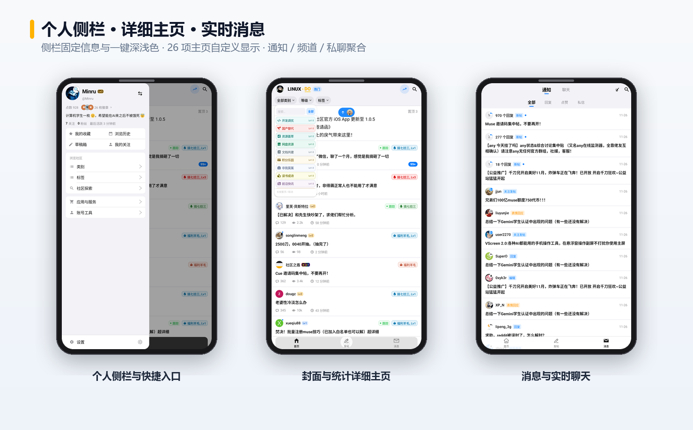

<div align="center">


<br />

<h1>LINUX DO 增强版</h1>

<p>
  面向 <a href="https://linux.do/">LINUX DO</a> 社区的原生 Android 客户端<br />
  基于 <a href="https://github.com/xuemk/linuxdo-android">xuemk/linuxdo-android</a> 独立维护 · 免费 · 非商业 · 无广告
</p>

<p>
  <a href="https://github.com/Mingrui-Ai/linuxdo-android/releases/tag/enhanced-v1.2.5">
    
  </a>
  
  
  <a href="./LICENSE">
    
  </a>
</p>

<p>
  <a href="https://github.com/Mingrui-Ai/linuxdo-android/releases/tag/enhanced-v1.2.5"><strong>⬇️ 下载增强版 1.2.5 APK</strong></a>
  &nbsp;·&nbsp;
  <a href="#-动态演示">动态演示</a>
  &nbsp;·&nbsp;
  <a href="#-界面一览">界面一览</a>
  &nbsp;·&nbsp;
  <a href="#-v125-更新">v1.2.5 更新</a>
  &nbsp;·&nbsp;
  <a href="#-下载与构建">构建指南</a>
</p>

</div>

---

## ✨ 动态演示

<div align="center">
<table>
  <tr>
    <td align="center" width="50%">
      <strong>多维筛选 · 动态排序 · 快捷手势</strong><br /><br />
      
    </td>
    <td align="center" width="50%">
      <strong>进帖自动跟踪 · 顶栏三按钮 · 帖内搜索</strong><br /><br />
      
    </td>
  </tr>
</table>
</div>

---

## 📱 界面一览

### 首页筛选与快捷手势


### 清爽读帖与自动跟踪


### 个人侧栏 · 详细主页 · 实时消息


### 浅色 & 深色自适应


---

## 🚀 核心特性

| 模块 | 亮点 |
| --- | --- |
| **首页筛选与排序** | `类别 / 等级 / 标签` 三维度自由组合，下拉菜单仅展示具体选项，通过已选胶囊的 × 或重置清除筛选，支持长按置顶与排序；6 项排序（最新 / 最新动态 / 最新发布 / 热门 / 点赞 / 浏览），按筛选组合独立记忆。“最新”跟随网站默认，分类可能按发帖时间排列；“最新动态”明确请求最近活动优先；点赞按整个话题总赞数（含回复）。紧凑排序菜单使用简短说明，首页、分类及标签页共用；本地预览后正常拉取远端结果，取消或失败后结束加载，限流时保留内容并提示重试；范围搜索自动带入当前筛选。 |
| **清爽刷帖与跟踪** | 默认阅读正文 3 秒后自动切换为「跟踪」，可在设置 → 阅读与浏览中关闭或自定等待秒数；仅计算前台连续阅读，保留手动通知设置；头像蓝点表示尚未看过，正文在前台显示 1.2 秒后本机消点，按账号保存，刷新、切换筛选或重启不依赖远端回执；未读回复仍独立用 `+N` / `99+` 提示，实际楼层与时长继续按原规则同步；主页左滑帖子一键「关注 / 免打扰」；顶栏精简为「搜索 / 编辑 / 铃铛四态」三按钮；详情页回复排序与筛选下拉栏统一；X 风格新帖头像胶囊提示，左侧头像叠在最上层。 |
| **消息与实时聊天** | 通知、频道、私聊集中于「消息」页，支持实时推送、批量已读、搜索与下拉刷新；底栏只显示图标，中间加号用于发帖，保留消息未读角标；横滑即可在首页与消息间切换，二级页面统一自动隐藏底栏。 |
| **个人主页与侧栏** | 侧栏固定展示等级、状态、点数、勋章、简介与关注粉丝；详细主页支持 26 项自定义显示开关、封面大图与原生资料编辑；头像资料卡背景覆盖紧凑拖动栏，右侧可快捷关注或聊天；详细主页头像右侧纵向显示关注和聊天，右上角提供分享、通知铃铛与更多菜单。 |
| **收藏、草稿与记录** | 徽章、草稿、关注、历史和收藏页统一顶栏与筛选样式；收藏支持标题与内容搜索；草稿可按新话题或回复筛选，回复草稿补充原帖作者头像。 |
| **帖子表情回应** | 长按点赞选择表情，按钮直接显示当前所选表情、不带红色背景圈，点击可取消、长按可更换；回应图标按数量降序排列，末尾仅显示总数，与网页一致；提交中防止重复操作，失败恢复原表情与计数。 |
| **回复编辑与恢复** | 回帖输入框支持紧凑模式、全屏 Markdown 工具栏和实时预览，可插入折叠总结；优化键盘展开与关闭，压缩简评输入栏。首页翻页失败后从失败页重试，帖子加载失败保留已选作者；小程序授权状态恢复时及时显示授权页，重进失败会话时重新初始化。 |
| **回复栏与实时提示** | 回复栏与顶栏同色，无上下分隔线和吸顶阴影，排序按钮与铃铛对齐。排序菜单可选「默认／全部展开」：默认保留楼中楼，只排序一级回帖，回复数按其下全部可见嵌套回复数量计算；全部展开时每层独立按时间、点赞或回复数排序。数量排序先补齐全帖可见楼层；楼中楼「查看全部回复」与「收起回复」统一右侧对齐。筛选右侧按网站实时状态显示头像与「正在回复」三点动画，无人回复、离开页面或连接失败时隐藏，复用话题实时连接。 |
| **网络与细节体验** | 内置 DoH / ECH 与「内置网络 / 跟随系统」切换；图片与业务请求队列隔离；本地常用小程序广场（支持内置/外部打开）；全新「曜石黑底 · 跃升 L+」品牌图标与登录页。 |

用户通知铃铛与网页版共用常规、免打扰和忽略设置；忽略按论坛权限开放，选择时限后生效。主页右上角分享和更多按钮随主题显示黑白色，铃铛按状态配色，忽略显示斜杠眼睛；下拉菜单与帖子铃铛共用样式。资料头像去掉黑白描边，右侧关注和聊天保留图标与文字，按钮均为 76×36dp、间距 4dp，整体与 78dp 头像居中对齐。通知读取轻量资料接口，30 秒内复用已同步状态并合并重复读取，过期时后台刷新，主页下拉刷新可主动同步。移除侧栏本地黑名单、旧名单存储及本地帖子过滤，旧名单不会自动变成网页忽略关系；常规浏览保留帖子缓存，忽略状态变化后返回帖子重新加载服务端内容。

---

## 📦 v1.2.5 更新

### 首页与筛选

- 修复分类筛选后长时间转圈、无法加载新帖的问题。
- 限流时保留已加载内容，并提示等待后重试。
- 移除三个筛选菜单的“全部”选项，可用 × 或“重置”清除筛选。
- 底栏去掉小字，中间改为发帖加号。

### 个人资料

- 资料卡背景完整覆盖顶部，头像边缘与按钮布局更协调。
- 新增分享、关注、聊天快捷入口，统一通知菜单样式。
- 优化铃铛同步，移除本地黑名单，改用网页版免打扰／忽略。

### 列表页面

- 统一徽章、草稿、关注、历史和收藏页的顶栏与筛选样式。
- 收藏支持标题与内容搜索；回复草稿补充原帖作者头像。
- 更新弹窗按主题分组，标题与条目分层显示，长文字对齐更清楚。

---

## ⬇️ 下载与构建

### 下载安装

前往 [Releases](https://github.com/Mingrui-Ai/linuxdo-android/releases/tag/enhanced-v1.2.5) 下载 **`linuxdo-enhanced-1.2.5-arm64-v8a.apk`**（Android 8.0+ / `arm64-v8a`）。

- 包名 `org.linuxdo.android.enhanced`，独立签名，可与原版共存；从增强版 `1.0 / 1.1 / 1.1.1 / 1.2.0` 升级可直接覆盖保留数据，并支持应用内自动检查更新。
- 公开 Release 仅发布正式版 APK，附带 `version.json`、`SHA256SUMS` 与公开签名证书 `release-certificate.pem`。

<details>
<summary><strong>🛠️ 本地编译与签名构建指南（点击展开）</strong></summary>

- 环境要求：JDK 21、Android SDK 36，本地 `local.properties` 配置 `sdk.dir`（不提交）。

```powershell
git clone --branch master --single-branch https://github.com/Mingrui-Ai/linuxdo-android.git
cd linuxdo-android

# 编译 Debug 包（app/build/outputs/apk/debug/app-debug.apk）
.\gradlew.bat :app:assembleDebug

# 编译并覆盖安装到已连接设备（-Performance 开启性能构建 + ART 预编译）
.\run-debug.ps1 -DeviceSerial "设备序列号" -Performance
```

正式版签名构建：在根目录配置本地 `keystore.properties`（`storeFile` / `storePassword` / `keyAlias` / `keyPassword`，不提交），运行 `./gradlew :app:assembleRelease`。

</details>

---

## 📜 授权与致谢

原作者 **xuemk** 已于 2026 年 11 月 23 日[明确授权非商业修改、公开维护与免费分发衍生 APK](https://github.com/xuemk/linuxdo-android/issues/15#issuecomment-7101351472)。本项目遵循 [LinuxDo Android Non-Commercial License](./LICENSE)（非商业、无广告、保留原作者署名与独立包名/签名/图标），第三方依赖遵循各自许可证。

感谢 [xuemk](https://github.com/xuemk) 的开源基础与 [LINUX DO](https://linux.do/) 社区支持（[原项目帖](https://linux.do/t/topic/2998703)）。欢迎向 `master` 分支提交 [PR / Issue](https://github.com/Mingrui-Ai/linuxdo-android/pulls)。
